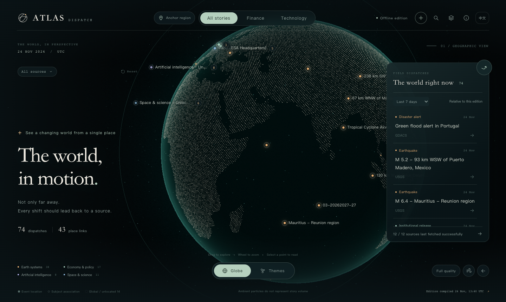
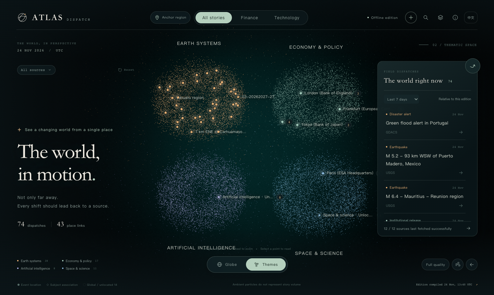
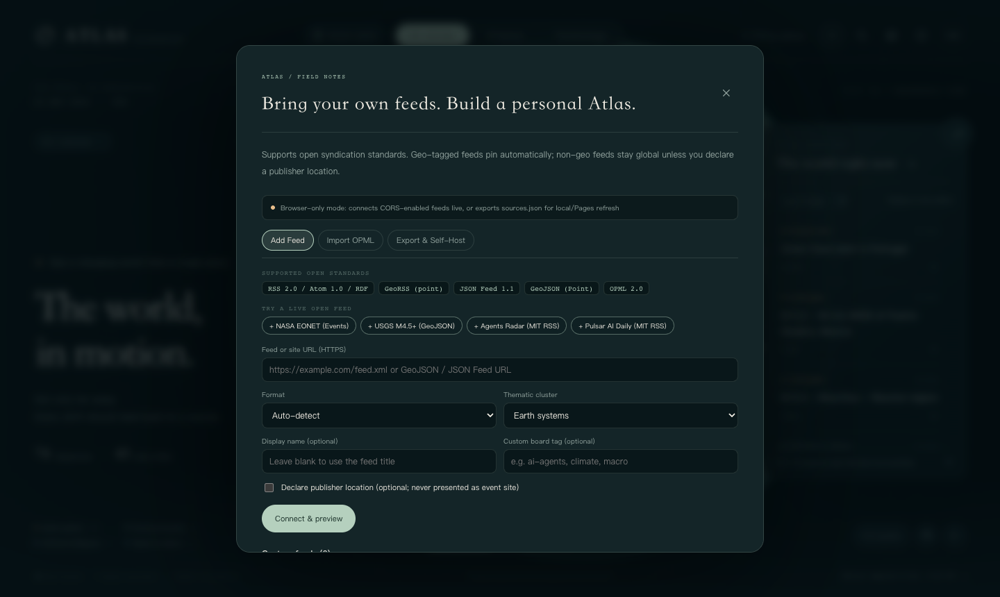
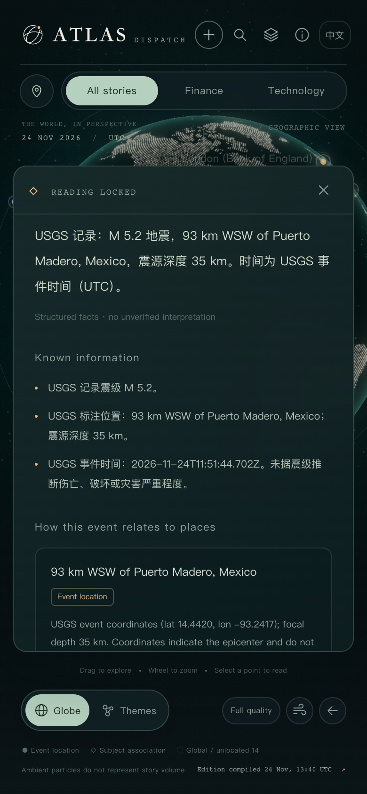
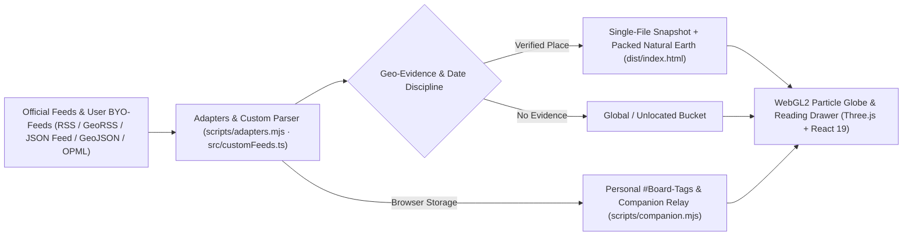

<div align="center">


# Atlas Dispatch

**A local-first 3D WebGL2 globe for open news & syndication feeds — evidence-based geolocation, BYO-Feeds, zero backend, single-file offline HTML.**

[](https://archibald-nice.github.io/atlas-dispatch/)
[](https://github.com/archibald-nice/atlas-dispatch/actions/workflows/update-pages.yml)
[](LICENSE)
[](package.json)
[](#quick-start)
[](#architecture)

<p>
  <a href="https://archibald-nice.github.io/atlas-dispatch/">Live Demo</a> &nbsp;·&nbsp;
  <a href="#highlights">Highlights</a> &nbsp;·&nbsp;
  <a href="#bring-your-own-feeds">BYO Feeds</a> &nbsp;·&nbsp;
  <a href="#deploy-your-own-atlas-in-5-minutes">5-Min Deploy</a> &nbsp;·&nbsp;
  <a href="#architecture">Architecture</a> &nbsp;·&nbsp;
  <a href="#chinese-overview">中文简介</a>
</p>

</div>

<a href="https://archibald-nice.github.io/atlas-dispatch/">
  
</a>

> [!IMPORTANT]
> **When uncertain, do not guess.** Events without verifiable geographic evidence stay in *Global / unlocated* instead of being pinned to random capitals. Publisher headquarters (`publisher`), explicit mentions (`subject`), and actual event sites (`event`) are strictly separated — and date-only sources preserve date precision without fabricating timestamps or timezones.

---

## Highlights

- **Globe First, Reader Second** — Interactive **WebGL2** particle Earth backed by **242 Natural Earth country & territory outlines**, delta-varint packed for minimal payload (~1.9 MiB total single-file bundle).
- **Geographic View ↔ Thematic Space** — Smooth 3D particle morph between Earth coordinates and editorial topic clusters (`Earth & Climate`, `Economy & Policy`, `AI & Models`, `Space & Exploration`).
- **Locked Context Reading** — Filtering, switching boards, or dragging the globe never dismisses an open dispatch. Every card cites its primary source URL, coordinate precision, and location evidence.
- **Zero-Install Offline Build** — `npm run build` compiles React 19, Three.js, GLSL shaders, Natural Earth outlines, and your verified snapshot into a single self-contained `dist/index.html`. Double-click from disk; zero server or tracking.
- **Bilingual Auto-Detection** — Automatically opens in **English** or **Chinese (简体中文)** based on browser locale, with instant top-bar switching and keyboard shortcuts (`/`, `Esc`, `Tab`).

<table>
  <tr>
    <td width="50%" valign="top">
      
      <p align="center"><strong>02 / Thematic Space</strong> — GPU morph into topic constellations across Earth, Economy, AI, and Space.</p>
    </td>
    <td width="50%" valign="top">
      
      <p align="center"><strong>BYO-Feeds Source Studio</strong> — Connect live RSS, GeoRSS, JSON Feed 1.1, Point GeoJSON, or import OPML directly in-app.</p>
    </td>
  </tr>
  <tr>
    <td width="50%" valign="top">
      
      <p align="center"><strong>Responsive Mobile Reader</strong> — Evidence-tagged locations, precision timestamps, and source attribution on narrow screens.</p>
    </td>
    <td width="50%" valign="middle">
      <h3>Curate Your Private Atlas</h3>
      <ul>
        <li>Add any open feed via the <strong>+</strong> button and assign custom <code>#board-tags</code> (filtered in real time in the dispatch rail).</li>
        <li>Bulk-import subscriptions from Feedly / Inoreader / NetNewsWire via <strong>OPML 2.0</strong> — folder names automatically become board tags.</li>
        <li>Export your personal bundle as portable <code>sources.json</code> or <strong>OPML 2.0</strong> for self-hosting on GitHub Pages.</li>
        <li>Optional <code>npm run companion</code> local server adds HTML <code>&lt;link rel="alternate"&gt;</code> auto-discovery and SSRF-guarded CORS relay for desktop use.</li>
      </ul>
    </td>
  </tr>
</table>

---

## Bring Your Own Feeds

> [!TIP]
> **CORS-Free Desktop Mode:** Static hosting works immediately with CORS-enabled feeds (NASA EONET, USGS GeoJSON, Fediverse/GitHub/Cloudflare blogs, etc.). For personal reading of any standard RSS/Atom site without CORS headers, run `npm run companion` locally — requests go through an SSRF-guarded local proxy on `127.0.0.1`.

### Supported Open Standards

| Format / Standard | Coordinate & Metadata Extraction | Custom Tagging |
| --- | --- | --- |
| **RSS 2.0 / Atom 1.0 / RDF** | Clean title, summary, link, ISO/RFC date; optional manual HQ pin or unlocated | User `#tags` |
| **GeoRSS** (`<georss:point>`, `<geo:Point>`) | Exact event coordinates verified onto globe | User `#tags` |
| **JSON Feed 1.1** | Official items + optional `_geo` coordinates & feed tags | Feed + user `#tags` |
| **GeoJSON** (`FeatureCollection`) | `Point` geometries plotted as live geographic dispatches | User `#tags` |
| **NASA EONET v3 & GDACS** | Real-time natural events & global alerts across continents | Built-in adapters |
| **OPML 2.0** | One-click import/export of nested subscription lists | OPML folder → `#tag` |

### Run Modes

| Mode | Command / Entry | Persistence | Network Requirements |
| --- | --- | --- | --- |
| **Single-File Offline** | Open `dist/index.html` | Built-in snapshot + browser `localStorage` | Zero remote requests |
| **Static Hosting / Pages** | Deploy `dist/` via GitHub Actions | Scheduled CI snapshot + browser BYO feeds | HTTPS for live CORS feeds |
| **Local Companion** | `npm run companion` | Local disk + browser `localStorage` + feed sniffing | Direct localhost relay (SSRF-guarded) |

---

## Architecture



---

## Quick Start

Requires **Node.js 22.18+** and a **WebGL2**-capable browser.

```sh
npm ci --ignore-scripts
npm run build
# Open dist/index.html directly from disk — no server required.

# Or start the local companion server for CORS-free feed discovery & live additions:
npm run companion
```

Verification commands:

```sh
npm run typecheck
npm test
```

---

## Deploy Your Own Atlas in 5 Minutes

1. Click **Use this template** (or fork this repository) on GitHub.
2. Customize [`scripts/sources.json`](scripts/sources.json) or copy a starter pack from [`presets/`](presets/) (Global Public Science, Tech & Labs, Central Banks & Policy).
3. Enable **Settings → Pages → Build and deployment → GitHub Actions**.
4. [`update-pages.yml`](.github/workflows/update-pages.yml) verifies types and tests, refreshes your feeds every **6 hours**, retains the last valid snapshot if upstream feeds fail, and publishes to your GitHub Pages URL.

---

## License & Boundaries

- **Code:** First-party source code is licensed under [**Apache-2.0**](LICENSE).
- **Map Geometry:** Bundled country & coastline shapes derive from [**Natural Earth**](THIRD_PARTY_NOTICES.txt) (public domain).
- **Content Rights:** Feed titles, summaries, and links remain subject to their respective publishers' terms; see [`docs/PUBLICATION.md`](docs/PUBLICATION.md) before redistributing third-party feeds publicly.

---

<details id="chinese-overview">
<summary><strong>中文简介 · 环讯 Atlas（点击展开）</strong></summary>

### 环讯 Atlas (Atlas Dispatch)

**本地优先、零后端、单文件离线的 3D 全球资讯地球仪。**

- **地球为主，列表为辅**：WebGL2 粒子地球内置 242 个 Natural Earth 国家与地区轮廓，支持在**地理视图**与**主题空间**（自然地球 / 经济政策 / AI 模型 / 太空探索）之间平滑形变。
- **有证据才标注**：严格区分**事件发生地**（`event`）、**主体关联地**（`subject`）与**发布机构所在地**（`publisher`）；没有位置证据的信息保留在「全球 / 未定位」，只给日期的来源不伪造时刻与时区。
- **接入你的信源（私人环讯）**：点击顶部 **+** 即可直连 RSS / Atom / GeoRSS / JSON Feed 1.1 / Point GeoJSON，或直接导入 **OPML 2.0**（目录自动转为自定义 `#板块标签`）。桌面端运行 `npm run companion` 还可启用带 SSRF 防护的本地伴侣代理与网页 Feed 自动嗅探。
- **单文件离线打包**：`npm run build` 将全部界面、着色器、地理边界与快照编译为一个约 1.9 MiB 的 `dist/index.html`，双击即可离线打开。

```sh
npm ci --ignore-scripts
npm run build       # 构建单文件 dist/index.html
npm run companion   # 启动本地伴侣模式（支持无 CORS 限制嗅探与直连）
```

</details>
